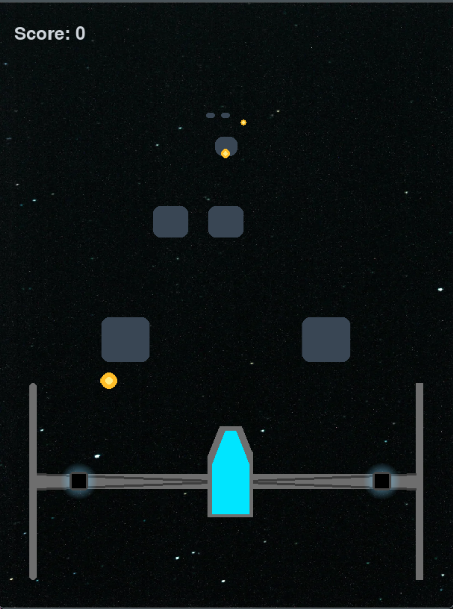

# Space Glider
*This game is still under development

A simple endless runner game built with Pygame where you collect coins and destroy meteors to increase your score with camera integration using MediaPipe.



## How To Play

You do not need Python or Pygame installed on your computer to play this game. Simply download the standalone executable:

1. Go to the **[Releases](https://github.com/MaryamShaikh320/endless-runner)** page on the right side of this repository.
2. Click on the latest version
3. Under the **Assets** dropdown at the bottom of the release notes, click on **'space-glider.zip'** to download it.
4. Right-click on the downloaded zip file and click Extract.
5. Open the newly extracted folder and double-click **'main.exe'** to launch the game.

Note: Both the Pygame and OpenCV windows will open.

## Controls

**To change modes, press q.**

In keyboard mode:
- **Right/Left Arrow Keys** - Move the gunner.
- **Space** - Shoot.

In camera mode:
- **Move right/left physically to move the gunner on screen**

Coins count as half a point towards your score.
Meteors count as one full point.

## Running From Source (For Developers)

If you want to view the source code instead of using the executable:

1. Clone this repository:
   ```bash
   git clone https://github.com/MaryamShaikh320/endless-runner
   ```
2. Create a virtual enviroment
   ```bash
   python -m venv .venv
   ```
3. Activate the virtual enviroment:
   ```bash
   source .venv\Scripts\activate
   ```
4. Install the required dependencies:
   ```bash
   pip install -r requirements.txt
   ```
5. Run the game:
   ```bash
   python main.py
   ```
